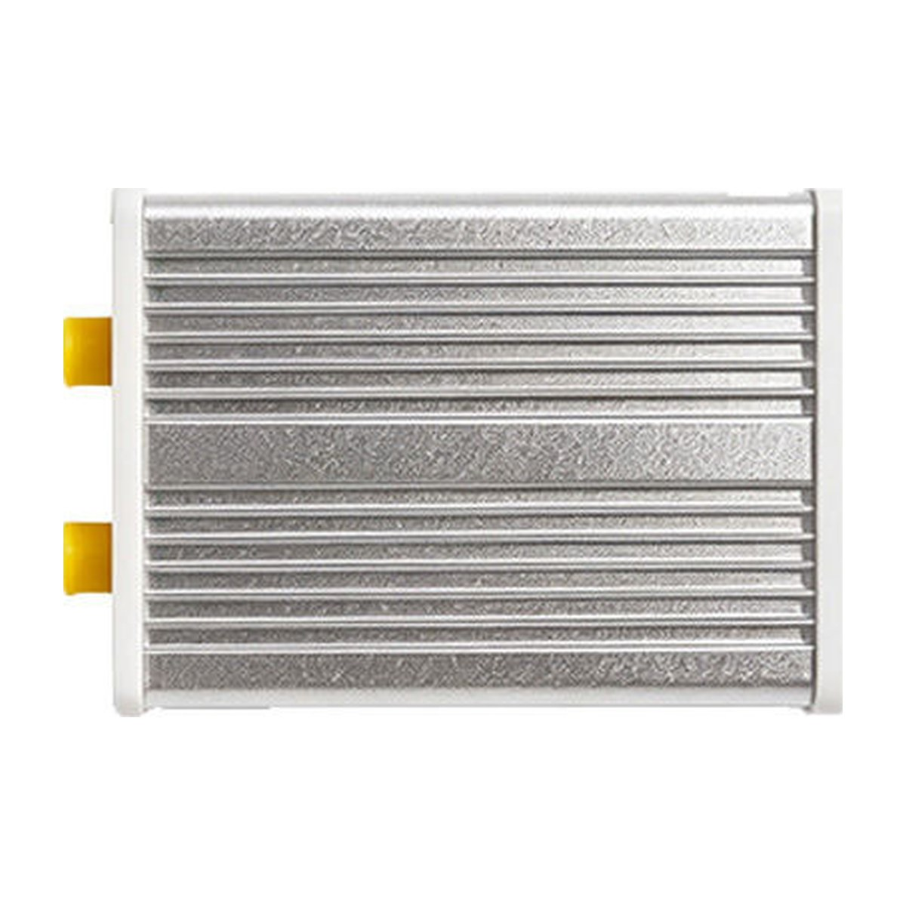
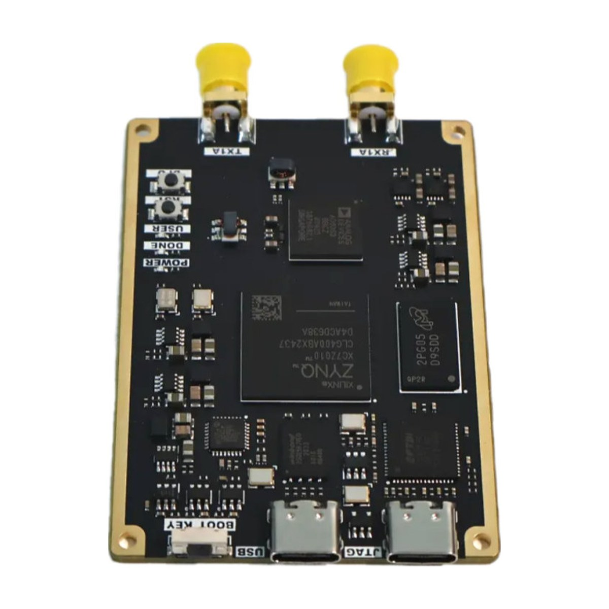

# 7010_AD9363_SDR_Mini

Schematic, firmware and documentation for the **OpenSourceSDRLab 7010 AD9363 SDR Mini**, a PlutoSDR-compatible software-defined radio with a Xilinx Zynq-7010 SoC and the Analog Devices AD9363 RF transceiver, with on-board JTAG/UART and FLASH or JTAG boot.

The board is sold in two versions: **with an aluminium enclosure** and **as a bare board without enclosure**. Both versions use the same board, the same schematic and the same factory firmware, so everything in this repository applies to both.

  
  

## Product links

| Version | Product page |
|---|---|
| **With aluminium enclosure** | <https://opensourcesdrlab.com/products/7010-ad9363-sdr-mini> |
| **Without enclosure (bare board)** | <https://opensourcesdrlab.com/products/7010-ad9363-sdr-mini-development-board-support-for-flash-and-jtag-boot-modes> |

> The former repository [7010_SDR_Mini](https://github.com/OpenSourceSDRLab/7010_SDR_Mini) (version without enclosure) has been merged into this repository and is archived.

## About the board

- RF transceiver: Analog Devices **AD9363**, one transmit and one receive channel on SMA connectors (TX1A, RX1A), 0.5 ppm TCXO
- SoC: Xilinx **Zynq-7010** (XC7Z010, CLG400 package), 512 MB DDR3, 32 MB Quad-SPI flash
- USB: two USB-C ports; **OTG** (USB 2.0 through a USB3320 PHY, the PlutoSDR USB interface) and **JTAG** (on-board FT2232H JTAG and serial-console bridge). Either port can power the board.
- Boot: from the Quad-SPI flash at power-up; press **BOOT_KEY** to switch to JTAG boot. A **DFU** button starts the firmware-update mode.
- Firmware: Analog Devices PlutoSDR firmware **v0.38**, adapted to this board, pre-installed; works with IIO Oscilloscope, SDR# / SDR++ (PlutoSDR plug-ins), GNU Radio and MATLAB like an ADALM-PLUTO
- Differences from the Analog Devices ADALM-PLUTO: no ADM1177 power monitor, added FT2232H JTAG + UART bridge, Zynq XC7Z010-CLG400

## Quick start

1. Install the PlutoSDR USB drivers from Analog Devices (Windows) and connect the **OTG** port to the PC.
2. After about 30 seconds the board appears as a PlutoSDR (network adapter and mass-storage drive).
3. Open IIO Oscilloscope and connect to the device.

The full steps, including firmware update and recovery, are in the **[Quick Start Guide](docs/Quick-Start-Guide.md)** ([PDF](docs/Quick-Start-Guide.pdf)).

## Repository layout

| Path | Contents |
|---|---|
| `hardware/7010_AD9363_SDR_Mini_Schematic.pdf` | Board schematic (PDF) |
| `hardware/7010_AD9363_SDR_Mini_Schematic_PA-revision.pdf` | Schematic of the revision with a transmit amplifier (ADL5544) and a changed power stage |
| `docs/` | Quick Start Guide (Markdown and PDF) |
| `images/` | Product photos |

## Downloads (Releases)

Large files are attached to the [Releases](../../releases) page instead of being stored in the repository:

| File | Contents |
|---|---|
| `7010_AD9363_SDR_Mini_firmware_v0.38.zip` | Factory firmware v0.38: `pluto.dfu`, `uboot-env.dfu` (DFU update), `boot.bin`, `fsbl.elf` (flash recovery) |
| `SHA256SUMS.txt` | SHA-256 checksums of the files above |

Check a download with `shasum -a 256 -c SHA256SUMS.txt` (macOS / Linux) or `certutil -hashfile <file> SHA256` (Windows).

## Licence

Files created by OpenSourceSDRLab are released under the [Apache License 2.0](LICENSE). The firmware is built from the Analog Devices PlutoSDR firmware and contains Linux, U-Boot, Buildroot and other open-source software under their own licences (mostly GPL); see [NOTICE.md](NOTICE.md), which also explains how to obtain the corresponding source code.

## Support

- Email: support@opensourcesdrlab.com
- Forum: <https://forum.opensourcesdrlab.com>
- Discord: <https://discord.gg/nnxY6DkmvT>
- Blog and user manuals: <https://blog.opensourcesdrlab.com>

---
© 2026 OpenSourceSDRLab. All rights reserved. · <a href="https://www.opensourcesdrlab.com">www.opensourcesdrlab.com</a>
